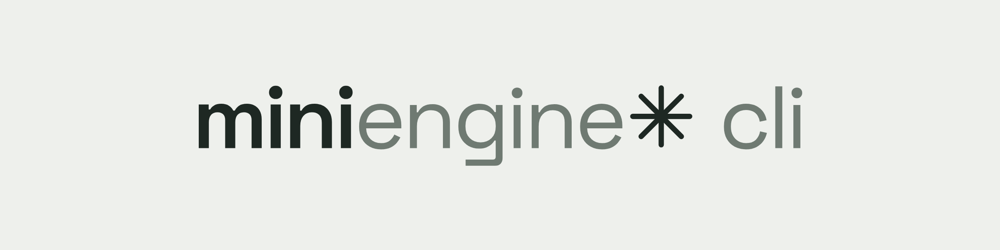

<picture>
  <source media="(prefers-color-scheme: dark)" srcset=".github/assets/banner-donker.png">
  
</picture>

# Mini Engine CLI

Met de Mini Engine CLI maak, test en publiceer je je eigen partygames voor Mini Engine: een spel maken met `me init`, het op je eigen computer spelen met `me dev` (ook met telefoons op je wifi), controleren met `me doctor`, nieuwe versies uploaden, wisselen tussen versies en de game aan- of uitzetten.

Documentatie: [docs.miniengine.nl](https://docs.miniengine.nl/publiceren/cli.html). De routes die de CLI gebruikt, staan bij [API: ontwikkelaars](https://docs.miniengine.nl/api/ontwikkelaars.html).

De commando's heten `me` en `miniengine` (hetzelfde programma). Werkt met Mini Engine 0.3 of nieuwer; achievements en eigen sets in `manifest.json` hebben Mini Engine 0.5 nodig.

## Installeren

Je hebt Node.js 22 of nieuwer nodig. De CLI heeft geen andere afhankelijkheden.

```sh
npm install -g github:Casb02/mini-engine-cli
```

Of vanuit een checkout van deze repository:

```sh
npm install -g .
```

Controleer met `me --version`.

## Snel aan de slag

```sh
mkdir quizavond && cd quizavond
me init
```

`me init` stelt een paar vragen, elk met een standaard, dus Enter, Enter, Enter werkt ook:

- de titel, en het id op de server dat daaruit volgt (aan te passen);
- het startsjabloon: `stemmen`, `quiz`, `buzzer`, `beurten` of `leeg`;
- het aantal spelers;
- wie de kamer maakt: *Iedereen doet mee*, *TV* of allebei;
- het uiterlijk: MiniEngineUI met een thema, of eenvoudig;
- de taal van het spel: Nederlands of Engels;
- of de AI-skills voor Claude Code erbij moeten, als ze nog ontbreken.

Daarna zie je wat er klaarstaat en vraagt `me init` of je het meteen wilt proberen. Dan start `me dev` en opent je browser met de spelleider en twee spelers naast elkaar. Je hebt daarvoor geen dev key nodig.

Om te publiceren heb je wel een dev key nodig. Die krijg je van wie de Mini Engine-server beheert waar je naar publiceert. `me setup` loopt de server, je dev key en de skills met je langs; `me doctor` laat zien of alles klaarstaat. Daarna:

```sh
me game upload                                # eerste versie, meteen actief en zichtbaar
```

Pas daarna de game aan, verhoog `version` in `manifest.json` en upload opnieuw:

```sh
me game upload --activate
```

### Startsjablonen

| Sjabloon | Wat | Laat zien |
| --- | --- | --- |
| `stemmen` | Iedereen stemt ja of nee op één vraag; elk scherm toont de stand. | De wachtrij van de host, een host die meespeelt, een gedeeld scherm |
| `quiz` | Meerkeuzevragen op tijd, punten en een eindstand. | Geheime antwoorden in `host_state`, `data.json`, eigen sets (één vraag per regel), een achievement |
| `buzzer` | Wie drukt het snelst na het signaal? | `client.realtime` met de `ts` van de server; de host beslist eerlijk |
| `beurten` | Om de beurt dobbelen; een 1 kost je de punten van die beurt. | Beurten, spelers die weggaan, overslaan na 30 seconden offline |
| `leeg` | Een kaal begin: lobby, start, één voorbeeldzet en een einde. | Het kleinste rondje van actie naar host naar state |

Elk sjabloon is een werkend spel met `host_modes: ["playing", "tv"]`, spelregels in `assets/logic.js` met tests in `tests/logic.test.mjs`, alle woorden in `assets/texts.js`, een icoon, een README, `jsconfig.json` en `.meignore`.

Zonder vragen, bijvoorbeeld in een script:

```sh
me init quizavond --yes --template quiz --title "Quiz bij Dani" --players 2-8
```

## Commando's

Elk commando heeft `--help`, bijvoorbeeld `me game upload --help`.

### Inloggen

| Commando | Doet |
| --- | --- |
| `me auth [--server URL] [--token KEY]` | Vraagt je dev key (onzichtbare invoer), controleert hem bij de server en slaat hem op. Zonder terminal leest hij één regel van stdin. |
| `me auth status` | Laat zien met welke account, server en sleutel je werkt. |
| `me auth logout` | Haalt de dev key uit je configuratie. De sleutel zelf blijft geldig tot de beheerder hem intrekt. |

### Games

| Commando | Doet |
| --- | --- |
| `me game list` | Je games met actieve versie, status (aan, uit of geblokkeerd) en aantal versies. |
| `me game new <slug> [--dir MAP] [--template NAAM]` | Maakt een werkend spel vanuit een SDK-sjabloon in `./<slug>`, zonder vragen. Standaard de stemgame, in het Engels en eenvoudig opgemaakt; `--title`, `--players`, `--modes`, `--look`, `--theme` en `--lang` werken als bij `me init`. |
| `me game upload [map] [--activate] [--dry-run]` | Pakt de map in en uploadt hem als nieuwe versie. |
| `me game versions <id>` | Alle versies met grootte, hash en of een lopende room ze gebruikt. |
| `me game activate <id> <versie>` | Maakt een versie actief. Zo zet je ook een oudere versie terug. |
| `me game enable <id>` / `me game disable <id>` | Toont of verbergt de game. Lopende rooms spelen door. |
| `me game delete-version <id> <versie>` | Verwijdert één oude versie. |
| `me game prune <id> [--keep N] [--yes] [--dry-run]` | Verwijdert alle versies behalve de actieve en de nieuwste N (standaard 3). Versies die een lopende room gebruikt, blijven staan. |
| `me game delete <id> [--yes]` | Verwijdert de hele game met alle versies. |

`me game prune` en `me game delete` vragen om bevestiging. Zonder terminal (in een script) is `--yes` verplicht.

### Lokaal testen

| Commando | Wat |
| --- | --- |
| `me dev [map]` | Start een lokale, nagebootste engine voor je game en opent een overzicht met de spelleider, het scherm en de spelers naast elkaar. |
| `me dev --players 4 --set bord.json` | Met vier spelers, en met `bord.json` als eigen set in plaats van `data.json`. |
| `me dev --lan` | Ook telefoons op hetzelfde wifi doen mee, via het adres dat `me dev` toont. |

### AI-skills

De CLI bevat de skills uit de Mini Engine SDK voor Claude Code: `build-mini-engine-game`, `design-mini-engine-game-ui` en `mini-engine-ui` (MiniEngineUI, de rustige stijl van de demospellen als kant-en-klare kit).

| Commando | Doet |
| --- | --- |
| `me skill list` | Toont de meegeleverde skills. |
| `me skill install [naam…] [--project \| --path MAP] [--force]` | Installeert in `~/.claude/skills`, met `--project` in `./.claude/skills`, of in een eigen map. Een bestaande skill met andere inhoud wordt alleen met `--force` overschreven. |

### Begin hier

| Commando | Doet |
| --- | --- |
| `me init [map]` | Nieuw spel met een paar vragen, en daarna meteen `me dev`. |
| `me init [map] --yes --template quiz …` | Hetzelfde zonder vragen; `--json` voor scripts, `--dev` start `me dev` zonder te vragen. |
| `me setup` | Server, dev key, skills en een eerste game, met vragen. |
| `me setup --server URL --token KEY --no-skills --game SLUG` | Hetzelfde zonder vragen. `--yes` kiest overal de standaard. |
| `me doctor [map]` | Controleert Node.js, de CLI, de server, je dev key, de skills en het spel in deze map, met per probleem één oplossing. |

`me init` maakt het spel in de map waarin je staat als die leeg is (verborgen bestanden zoals `.git` tellen niet mee), anders in een nieuwe map met het id als naam. Zonder terminal, of met `--yes` of `--json`, vraagt het niets en gebruikt het je opties en verder de standaard: stemmen, MiniEngineUI, Nederlands, *Iedereen doet mee* en TV, en de ontbrekende AI-skills erbij. Met `--interactive` stelt het de vragen ook zonder terminal, met de antwoorden op stdin.

`me doctor` toont een lijst met ✓ en ✗, en onder elke ✗ wat je kunt doen:

```
✓ Node.js 22.12.0
✓ CLI 0.6.0 is de nieuwste versie
✓ Server https://miniengine.nl (standaard) is bereikbaar, Mini Engine 0.6.1
✗ Geen dev key voor https://miniengine.nl; uploaden kan nog niet. Spelen met me dev lukt wel.
    Vraag een dev key aan wie de server beheert en log in met: me auth
✓ AI-skills staan in ~/.claude/skills
✓ Spel quizavond 0.1.0 in .: 20 bestanden, 196,4 KiB, klaar om te uploaden

1 ding om op te lossen.
```

In een map met `manifest.json` doet doctor dezelfde controles als `me game upload --dry-run`, en kijkt hij of de pagina's alleen bestanden uit het spel laden. Ben je ingelogd, dan meldt hij ook of deze versie al op de server staat. Zonder internet slaat hij de controle op een nieuwere CLI over. De exitcode is 1 als er iets op te lossen is.

## Lokaal testen met me dev

Je hebt geen engine nodig om je game te testen:

```sh
cd mijn-spel
me dev
```

`me dev` controleert eerst `manifest.json` zoals `me game upload` dat doet en start dan een kleine server die de engine nabootst voor games met `runtime: "host"`: kamers, spelers en klaar zijn, state met versies, acties naar de spelleider, realtime, achievements en game-data (of een eigen set met `--set`). In de browser zie je de spelleider, het tv-scherm en de spelers naast elkaar. Elke stoel draait op een eigen poort, dus elke speler heeft een eigen sessie, net als op een eigen telefoon. Met **Speler toevoegen** schuift er iemand aan, met **Nieuwe kamer** begin je opnieuw. Is `default_host_mode` `"playing"`, dan speelt de spelleider mee zoals op de echte engine: hij heeft een eigen stoel die altijd klaar staat, en elke snapshot heeft `host_player_id`.

Pas je iets aan in de map, dan laden de stoelen opnieuw en blijft de kamer bestaan. Een fout in het manifest zie je in het overzicht en in de terminal. Gekregen achievements verschijnen in de terminal. De kamer krijgt de `default_host_mode` uit het manifest; wil je lokaal TV of een aparte spelleider proberen, zet die dan even als standaard. Alles staat alleen in het geheugen; stoppen doe je met Ctrl+C.

Het overzicht en elke stoel bedienen dezelfde adressen als de server, zoals `/api/v1/rooms` en `/room/CODE/ROL`. Zo kan een script met Playwright een hele kamer bespelen; de skill `build-mini-engine-game` levert daarvoor `scripts/play.mjs`.

Met `me dev --lan` luistert `me dev` ook op het netwerk. Het toont dan een adres zoals `http://192.168.1.20:3170/join`, en in het overzicht een QR-code. Een telefoon op hetzelfde wifi opent dat adres, kiest een naam en krijgt een eigen stoel; het overzicht toont die stoel zonder scherm. Iedereen op dat netwerk kan zo meedoen, dus gebruik `--lan` alleen op een netwerk dat je vertrouwt. Zonder `--lan` antwoordt `me dev` alleen aan je eigen computer. Bij **Nieuwe kamer** doen de telefoons opnieuw mee via hetzelfde adres.

`me dev` is een nabootsing. Hij volgt het protocol van de engine en de tests van de CLI draaien hem met dezelfde stappen als de echte engine, maar test je game voor een avond met vrienden ook een keer op een echte server, bijvoorbeeld met `me game upload` en een testversie.

## Uploaden

`me game upload` leest `id` en `version` uit `manifest.json`. Elke upload is een nieuwe versie, dus verhoog `version` (letters, cijfers en `. + _ -`, maximaal 64 tekens).

Niet meegestuurd worden:

- bestanden en mappen die met een punt beginnen (`.git`, `.env`, `.DS_Store`)
- `node_modules`, op elke diepte
- de map `tests/` in de hoofdmap van de game
- patronen uit `.meignore`

`.meignore` heeft één patroon per regel. `*` past binnen één map, `**` over mappen heen, een `/` aan het eind betekent alleen mappen, en een patroon met een `/` erin geldt vanaf de hoofdmap. Regels die met `#` beginnen zijn commentaar. `me init` en `me game new` zetten `jsconfig.json` en `types/` er alvast in, omdat die alleen voor je editor zijn.

```
*.psd
ontwerp/
assets/**/*.wav
```

Symlinks worden geweigerd. Voordat er iets verstuurd wordt, controleert de CLI de limieten van de server: maximaal 4096 bestanden, 2 MiB per bestand, 10 MiB in totaal, paden tot 255 bytes en 32 niveaus diep. Ook controleert hij dat de game `runtime: "host"` gebruikt, dat `host_modes` een of meer van `"playing"`, `"tv"` en `"moderator"` bevat (`"hostless"` is alleen voor ingebouwde games) met `default_host_mode` daarin, dat een eventueel `icon` klopt (zie hieronder) en dat `host.html` en `player.html` (en `display.html` als `has_display` aan staat) bestaan. Met `--dry-run` zie je wat er mee zou gaan.

De eerste versie van een nieuwe game wordt meteen actief: hij staat dan voor iedereen op de startpagina van die server. `me game upload` zegt dat er na de eerste upload bij, met het adres om een kamer te maken. Latere versies worden alleen actief met `--activate` of `me game activate`. Een room houdt de versie waarmee hij begon, ook als je intussen een andere versie activeert; zo'n versie staat in `me game versions` als in gebruik en kan pas weg als de room klaar is. Per account kun je 10 games hebben en per game 10 versies bewaren; ruim oude versies op met `me game prune`.

Na een geslaagde upload van een actieve versie toont de CLI waar je de game start: `<server>/home/new/<id>`. Bij een server ouder dan 0.5 is dat nog `/demo/new/<id>`.

### Iedereen doet mee, of TV

Een gezelschapsspel (bord, kaart, dobbel, tekenen) zet `host_modes: ["playing", "tv"]` met `"playing"` als standaard. Het formulier toont dan twee keuzes:

- **Iedereen doet mee** (`playing`, sinds Mini Engine 0.5.1): de maker heeft met dezelfde sleutel ook een stoel, met `player_id` in de credential en `host_player_id` in elke snapshot. Die stoel telt mee voor `max_players`, staat altijd klaar en houdt de start nooit tegen. De hostpagina ziet eruit als een telefoon van een speler, met alleen wat het spel van de maker nodig heeft (Start, Nieuw spel). Hij blijft scheidsrechter: hij stuurt geen acties, maar past zijn eigen zet direct toe met `setState`. Op zijn eigen stoel kan hij ook achievements krijgen.
- **TV** (`tv`, sinds 0.5.2): het apparaat dat de kamer maakt, is de tv. Het toont het spel, heeft geen stoel (`player_id` en `host_player_id` zijn `null`) en speelt niet mee; iedereen speelt op de telefoon. De eigenaar van de tv kan op de eigen telefoon achievements krijgen.

`moderator` (*Ik, als spelleider*) is voor een spel met een leider die niet meespeelt, zoals een quizmaster. Een nieuw spel van `me init` of `me game new` biedt `["playing", "tv"]`; zonder `host_modes` blijft het `["moderator"]`.

### Icoon

Een game kan een eigen icoon meenemen: `"icon": "assets/icoon.svg"`. Voor het uploaden controleert de CLI dezelfde regels als de engine: het pad begint met `assets/` en eindigt op `.svg`, het bestand zit in de upload, is hoogstens 64 KiB en geldige UTF-8, bevat `<svg` en bevat geen `<script`, `<foreignObject`, `javascript:` of `on…=`-attributen (hoofdletters maken niet uit). Maak het vierkant (`viewBox="0 0 48 48"`), met een eigen achtergrond (`rx="12"`), een of twee eenvoudige vormen in de kleuren van je game, zonder tekst, lettertypen of externe verwijzingen.

### Achievements en eigen sets

Sinds Mini Engine 0.5 kan `manifest.json` twee lijsten bevatten:

- `achievements`: hoogstens 50, elk met `id`, `title` en `description`.
- `set_kinds`: hoogstens 4 soorten eigen sets, elk met `id`, `title`, `description` en `schema`.

```json
"achievements": [
  { "id": "eerste-buzz", "title": "Eerste buzz", "description": "Druk als eerste op de knop." }
],
"set_kinds": [
  {
    "id": "bord",
    "title": "Eigen bord",
    "description": "Een eigen bord met categorieën en vragen.",
    "schema": { "type": "object", "additionalProperties": false, "properties": { "titel": { "type": "string", "maxLength": 60 } } }
  }
]
```

Voor het uploaden controleert de CLI de vorm: een `id` heeft 1 tot 48 kleine letters, cijfers, `_` of `-`, begint met een letter of cijfer en komt per lijst één keer voor; een titel heeft 1 tot 60 tekens en een beschrijving 1 tot 160, zonder regeleinden; `schema` is een object. Of het schema zelf klopt, controleert de server bij de upload.

Het overzicht na de upload en `me game upload --dry-run` tonen welke achievements en soorten sets de game heeft. Draait de server een versie ouder dan 0.5, dan krijg je voor het uploaden een waarschuwing: zo'n server negeert deze velden. De upload gaat wel door.

## Configuratie

De CLI bewaart zijn instellingen in `~/.config/miniengine/config.json` (of `$XDG_CONFIG_HOME/miniengine/config.json`):

```json
{ "server": "https://games.example.nl", "token": "med_…" }
```

Het bestand krijgt rechten `0600` en de map `0700`. Omgevingsvariabelen gaan voor het bestand:

| Variabele | Waarvoor |
| --- | --- |
| `MINIENGINE_SERVER` | Server-URL (standaard `https://miniengine.nl`) |
| `MINIENGINE_TOKEN` | Dev key |

`--server URL` gaat weer voor de omgeving en geldt voor één commando. Bij `me auth` en `me setup` wordt de server ook opgeslagen.

## Scripts

Elk commando kent `--json`. De uitvoer is dan één JSON-object op stdout, ook bij fouten:

```json
{ "error": { "code": "version_exists", "message": "Deze versie bestaat al.", "status": 409 } }
```

Exitcodes: `0` gelukt, `1` fout van de server of de CLI, `2` verkeerd gebruik (onbekend commando, ontbrekend argument, bevestiging nodig), `130` afgebroken.

```sh
export MINIENGINE_SERVER=https://games.example.nl
printf %s "$MINIENGINE_DEV_KEY" | me auth
me game upload ./ja-of-nee --activate --json
```

## Beveiliging

- Een dev key (`med_` gevolgd door 64 tekens) is een geheim: wie hem heeft, kan namens jou games uploaden, wijzigen en verwijderen. Zet hem niet in een repository en deel hem niet in een chat. `--token` komt in je shellgeschiedenis; plakken via `me auth` of stdin voorkomt dat.
- De CLI toont sleutels nooit volledig, alleen als `med_…abcd`.
- Geüploade games draaien op hetzelfde domein als Mini Engine, met hetzelfde vertrouwen als de ingebouwde games. Daarom krijgen alleen uitgenodigde ontwikkelaars een dev key.
- Lekt een sleutel, vraag dan wie de server beheert om hem in te trekken. `me auth logout` haalt hem alleen van je eigen computer.

## Ontwikkeling

```sh
npm test                 # controleert vendor/ en draait de tests (node --test)
npm run sync-vendor      # haalt sjablonen en skills opnieuw uit ../mini-engine-sdk
```

`vendor/sdk/` bevat een kopie van de sjablonen (`bin/`), de SDK (`dist/` en `types/`) en de skills (`skills/`) uit de Mini Engine SDK, in dezelfde indeling als de SDK zelf. Pas die bestanden niet met de hand aan: `scripts/sync-vendor.mjs` kopieert ze uit een SDK-checkout (`--sdk PAD` of `MINI_ENGINE_SDK`) en legt hashes en SDK-versie vast in `vendor/VENDOR.json`. `npm test` faalt als `vendor/` daarvan afwijkt.

De tests draaien tegen een nagebouwde server. `npm run e2e` draait de CLI tegen een echte testserver: uploaden, versies, rooms, aan en uit, opruimen en verwijderen. Het script zegt zelf welke gegevens van die server het nodig heeft. Gebruik het alleen tegen een testserver.
